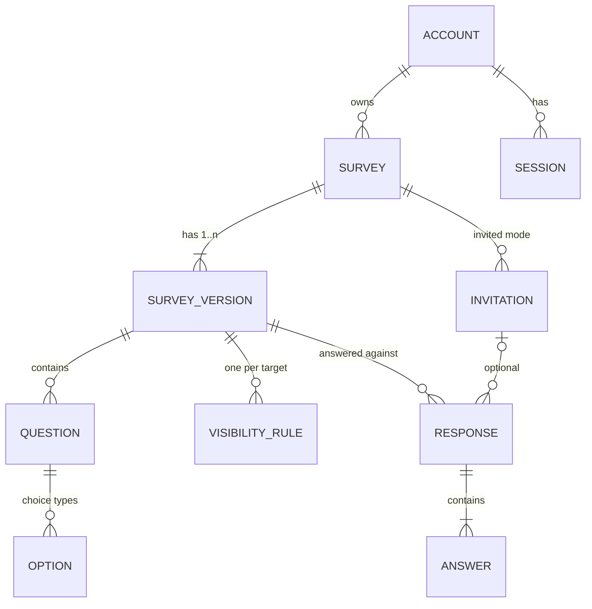

# Delfos development plan

Delfos is a survey platform: managers build surveys with conditional
logic, publish and version them, watch results arrive and export them;
respondents answer from the web or from a mobile application. This plan
says what gets built, in which order, with which stack and why, how long
each step takes at ten hours a week, and how the result stays alive
without attention. Decisions that are expensive to reverse have an
architecture decision record in `docs/adr/`; rules that every change must
follow are in `docs/engineering-rules.md`.

Status of this document: version 1, 2026-11-10, written before the first
line of application code. Every provider figure carries the date it was
checked; every estimate carries its assumptions.

## 1. Vision and success criterion

Delfos exists to show, with a running system and a readable repository,
how one engineer makes and documents decisions across a backend, a web
client and a mobile client. The domain is deliberately non-trivial: a form
builder with branching questions, published versions that keep collected
answers meaningful, live results and exports. The project is public from
its first commit, costs nothing to run, and must survive six months without
its maintainer.

Success is observable: a senior engineer who opens the repository for
fifteen minutes and uses the demo for ten concludes that the decisions were
deliberate, that the trade-offs are understood, and that the system works.
The repository is judged by its reasoning and its tests; the demo by
answering a survey with branching questions and seeing the results change.

Non-goals: ornamental layers, technology for its own sake, metrics as
targets, and a first slice so ambitious that it never ships.

## 2. Domain model

Two kinds of principal exist. A **manager** has an account, owns surveys
and sees only their own. A **respondent** has no account: in anonymous
mode they present nothing; in invited mode they present a single-use
token. An administrator is a flag on a manager account that grants account
management and nothing else.



Aggregates and invariants:

- **Survey**: owner, title, content language (`es` or `en`), status
  `DRAFT`, `PUBLISHED` or `CLOSED`, respondent mode `ANONYMOUS` or
  `INVITED`, optional closing time and maximum number of responses, and an
  opaque public identifier generated by the server. At most one draft
  version and at most one published version at any time.
- **Survey version**: numbered, immutable once published. Editing a
  published survey creates a new draft copied from the published version,
  keeping the stable keys of questions and options. Publishing the draft
  supersedes the previous version. A superseded version still accepts
  responses while the survey is published, so a respondent who loaded it
  before the new publication does not lose their answers.
- **Question**: stable key, position, type (`SINGLE_CHOICE`,
  `MULTIPLE_CHOICE`, `TEXT`, `NUMBER`, `SCALE`), prompt, required flag and
  per-type configuration. Positions are unique and contiguous within a
  version; order matters because rules depend on it. Two questions in
  different versions are the same question when they share a key; they are
  comparable for aggregation when they also share a type and, for choice
  types, the same option keys.
- **Visibility rule**: at most one per question (section 3).
- **Response**: points to the version answered and, in invited mode, to
  the invitation; immutable once submitted; one typed answer per visible
  required question, none for hidden questions.
- **Account** and **session**: username and password hash, administrator
  flag, status; sessions as in ADR 0008.

Lifecycle: survey `DRAFT` → `PUBLISHED` → `CLOSED`, with closing by hand,
by date or by quota; no reopening (duplicate instead); deletion removes
versions and responses after client-side confirmation. Version `DRAFT` →
`PUBLISHED` → `SUPERSEDED`.

Personal data: none by design. Manager accounts hold a username and a
hash; respondents hold nothing; logs hold no IP addresses or bodies; rate
limiting counts in memory only.

## 3. Conditional rules

A rule is declarative data in the contract:

```json
{
  "targetQuestionKey": "q7",
  "match": "ALL",
  "conditions": [
    {
      "sourceQuestionKey": "q2",
      "operator": "EQUALS",
      "value": { "optionKey": "o2b" }
    },
    {
      "sourceQuestionKey": "q5",
      "operator": "GTE",
      "value": { "number": 3 }
    }
  ]
}
```

A question with a rule is visible only when the rule holds; one without a
rule is always visible. Conditions may only reference earlier questions,
so cycles cannot exist; validation reports unknown questions or options,
self and forward references, operator and value type mismatches,
duplicate rules and empty condition lists, all at once with paths. A
hidden question counts as unanswered for rules that depend on it; required
applies only to visible questions; answers to hidden questions are
rejected with `HIDDEN_QUESTION_ANSWERED`.

Operators by type: choice `EQUALS`, `NOT_EQUALS`, `IN`, `INCLUDES_ANY`,
`INCLUDES_ALL`, `EXCLUDES`; number and scale `EQ`, `NE`, `GT`, `GTE`, `LT`,
`LTE`, `BETWEEN`; all types `IS_ANSWERED`, `IS_NOT_ANSWERED`.

Where rules are evaluated: always on the server, at submission and through
a stateless evaluation endpoint the web client calls as answers change.
The evaluator lives in a pure Kotlin module shared with the mobile client,
which evaluates locally. A conformance suite of JSON cases in `contract/`
is run by the server from the first slice and by every evaluator that
exists. Alternative discarded and reopening conditions: ADR 0009.

## 4. API contract

`contract/openapi.yaml`, written by hand in OpenAPI 3.0.3, is the single
source of truth (ADR 0007). Generated from it: server interfaces and
validated DTOs (Kotlin, Spring), web types and client
(`openapi-typescript`, `openapi-fetch`), mobile models (Kotlin). Written by
hand: domain logic, semantic validation, tests.

Contract tests: API tests exercise the running application against a real
database and validate every request and response against the file; client
builds compile against generated types; `oasdiff breaking` runs in CI
against `main` and against the last released contract.

Versioning: prefix `/api/v1`. Until launch, breaking changes are allowed
with a changelog entry. After the first distributed client, `v1` only
grows; a breaking change opens `/api/v2` with a deprecation period
announced in the changelog and in response headers.

Errors: one shape, Problem Details (`application/problem+json`) with
`type`, `title`, `status`, `detail`, `instance`, a stable `code` and an
`errors[]` list of `{path, code, params}`. Codes are the contract; clients
translate. Pagination: opaque `cursor` and bounded `limit` on every list.
Authentication: two declared schemes, `sessionCookie` for browsers and
`sessionToken` (bearer) for other clients, carrying the same opaque token;
public respondent operations carry no security.

Operations by slice (S1a is the first public slice; see section 15):

| Operation | Slice |
| --- | --- |
| `POST /auth/sessions`, `DELETE /auth/sessions/current`, `GET /auth/me` | S1a |
| `GET`, `POST /surveys`; `GET`, `PATCH`, `DELETE /surveys/{id}` | S1a |
| `POST /surveys/{id}/publish`, `POST /surveys/{id}/close` | S1a |
| `GET /surveys/{id}/versions`, `GET /surveys/{id}/versions/{n}` | S1a |
| `GET`, `PUT /surveys/{id}/draft`; `POST /surveys/{id}/draft` | S1a (API), S2 (editor) |
| `GET /surveys/{id}/versions/{n}/results`; `GET /surveys/{id}/results?scope=comparable` | S1a |
| `GET /surveys/{id}/versions/{n}/responses`; `.../answers?questionKey=` | S1a |
| `GET /public/surveys/{publicId}` | S1a |
| `POST /public/surveys/{publicId}/evaluations` | S1a |
| `POST /public/surveys/{publicId}/responses` | S1a |
| `GET /surveys/{id}/versions/{n}/export.csv` | S2 |
| `POST`, `GET /surveys/{id}/invitations`; `DELETE /surveys/{id}/invitations/{id}` | S3 |
| `GET`, `POST /accounts`; `POST /accounts/{id}/disable` | S3 |
| `GET /health`, `GET /api/docs`, `GET /api/openapi.yaml` | S1a |

## 5. Data and migrations

PostgreSQL 18 on Neon; schema only in Flyway migrations; Hibernate in
`validate` mode; aggregations in SQL (ADR 0003). Initial schema: the
entities of section 2, with typed answer storage (`option_keys text[]`,
`number_value numeric`, `text_value text`) so results aggregate in the
database, `jsonb` for rules validated against the contract schema, and
uniqueness on `(version_id, position)`, `(question_id, position)`,
`(response_id, question_key)`, `(survey_id, number)` and `public_id`.

Seed: one idempotent seed in code, shared by the public demo, the local
start and the end-to-end tests. Accounts `demo-admin`, `demo-manager`,
`demo-manager-2` with documented demo passwords hashed at seed time.
Surveys for `demo-manager`, each existing as a Spanish and an English
survey: a valid unpublished draft; a published survey using all five
question types and every operator, with forty synthetic responses; a survey
with a superseded version 1 and a published version 2 with responses in
both; a closed survey with results; from S3, an invited-mode survey.
`demo-manager-2` owns one survey to show ownership boundaries. Reset: one
local command and, for the demo, a scheduled workflow calling a protected
administrative endpoint; the seed upserts by stable identifiers.

## 6. Authentication and authorization

Opaque session tokens (ADR 0008): 256-bit CSPRNG values stored hashed,
30-minute idle and 12-hour absolute timeouts, new token per login,
revocation by deletion, all sessions revoked when an account is disabled.
Web transport: `__Host-session` cookie with `HttpOnly`, `Secure` and
`SameSite=Strict`, plus a required custom header on mutating requests.
Mobile transport: bearer token in the platform keystore or keychain.
Passwords: BCrypt through Spring Security's delegating encoder.

Authorization is decided per resource in one place: every survey operation
checks that the survey belongs to the session's account; the administrator
flag grants account management only; the principal always comes from the
session or the invitation, never from a request body.

## 7. Live results and export

Results per version: per question, the number of answers; for choice
types, counts per option; for number and scale, count, mean, minimum,
maximum and, for scale, the distribution per value; for text, the count
with answers paginated separately. `scope=comparable` aggregates across
versions for comparable questions and marks the rest. Live updates by
polling every five seconds with `If-None-Match`; the server answers `304`
when nothing changed. Server-sent events are deferred until a test through
the hosting proxy passes (section 18).

Export: CSV per version from S2, one row per response and one column per
question, multiple choice as one column per option with 1 or 0, text
protected against formula injection, UTF-8 with byte-order mark, ISO 8601
timestamps, streamed. XLSX and an aggregated PDF report are deferred with
triggers; asynchronous export only when a measurement exceeds ten seconds
or ten thousand responses.

## 8. Stack

| Layer | Choice | Record |
| --- | --- | --- |
| Architecture | One central API, clients through the contract | ADR 0001 |
| Backend | Kotlin 2.4, Spring Boot 4.1, Java 25, Gradle; shared pure Kotlin module | ADR 0002 |
| Database | PostgreSQL 18 on Neon, Flyway, Hibernate `validate`, JdbcTemplate for aggregates | ADR 0003 |
| Web | React 19, TypeScript, Vite, React Router, TanStack Query, react-hook-form, FormatJS, MUI, Vitest, Playwright, axe | ADR 0004 |
| Mobile | Kotlin Multiplatform with Compose Multiplatform, Android first, APK on Releases, iOS compiled in CI | ADR 0005 |
| Desktop | None; responsive web with an installable manifest | ADR 0006 |
| Contract | Hand-written OpenAPI 3.0.3, generated server interfaces and clients, `oasdiff` | ADR 0007 |
| Authentication | Opaque sessions, cookie and bearer, BCrypt | ADR 0008 |
| Rules | Declarative visibility rules, server evaluation, shared evaluator | ADR 0009 |
| Repository | One repository, composite Gradle builds, no orchestrator | ADR 0010 |
| Hosting | Render Free, Neon Free, Cloudflare Workers with static assets, GitHub registry and Actions, own domain | ADR 0016 |
| Dependencies | Dependabot groups, automated patch and minor merges, pinned toolchains and Actions | ADR 0012 |
| Workflow | GitHub Flow, squash, signed commits, `release-please` | ADR 0013 |
| Licence | MIT | ADR 0014 |
| Language | English codebase, Spanish-first bilingual interface, error codes | ADR 0015 |

Each record names the alternative discarded, the strongest argument
against the choice and the condition that reopens it.

## 9. Repository

Name `delfos`, public, on the maintainer's personal GitHub account. Package
root `com.manuelalejandro.delfos`. Structure, which a reader should grasp
from the top level alone:

```text
delfos/
  README.md  PLAN.md  LICENSE
  docs/adr/  docs/engineering-rules.md  docs/known-issues.md
  contract/  openapi.yaml, conformance/*.json, CHANGELOG.md
  api/       Kotlin, Spring Boot, Gradle; Flyway migrations
  shared/    Kotlin Multiplatform: rules evaluator and validator, contract models
  web/       React, Vite, npm
  mobile/    Kotlin Multiplatform with Compose (from S4)
  deploy/    Dockerfile, compose.yaml, render.yaml
  .github/   workflows, dependabot.yml, pull_request_template.md
```

What a reviewer sees in the first minute: a README with a five-row table
of modules and languages, the demo link and accounts, one command to run
everything, where the decisions are, and two badges (CI, licence). History
and flow: ADR 0013 and the engineering rules.

## 10. Tests

| Mechanism | Failure it catches | Slice | CI cost (estimate) |
| --- | --- | --- | --- |
| Unit tests on the shared module and the domain, including the conformance suite | A rule evaluated wrongly; an illegal lifecycle transition; a validator missing an error | S1a | under 1 minute |
| API tests on the full application with PostgreSQL in Testcontainers, validating requests and responses against the contract | Contract drift; a manager reading another manager's survey; a migration inconsistent with entities; a wrong error shape | S1a | 3 to 6 minutes, to be measured |
| Web unit tests (Vitest) on reducers and form schemas | Editor state transitions; validation mirrors | S2 | under 1 minute |
| One end-to-end path with Playwright and axe on a locally seeded instance: answer a branching survey, see results | The product not working as a whole; accessibility regressions on the public pages | S1a | 3 to 5 minutes |
| Contract compatibility (`oasdiff`) | A breaking change without a version bump | S1a | seconds |
| Mobile unit tests on the shared module per target | Evaluator divergence across targets | S4 | 2 to 4 minutes |

Deferred with triggers: mobile end-to-end tests (when a mobile client
exists and a flow breaks twice), mutation testing (when the domain exceeds
thirty business rules), performance tests (when a results query exceeds
500 ms on the seed). Coverage is reported, never targeted.

## 11. CI/CD and containers

GitHub Actions, free for the public repository (checked 2026-11-05).
Pipeline on every pull request and on `main`, with path filters: format and
lint; unit tests; API tests with Testcontainers (Docker is present on the
`ubuntu-24.04` runner, checked 2026-11-05); `oasdiff breaking`; web build in
both languages with the untranslated-keys check; CodeQL (eligible for
public repositories, checked 2026-11-10); container image build and push
to the GitHub registry on `main`; the end-to-end path with Playwright and
axe against a locally seeded API. Every gate blocks the merge; none is
advisory. Releases: `release-please` reads the Conventional Commits on
`main`, keeps a release pull request open with the changelog and the next
version, and tags the version when that pull request merges; 1.0.0 is
reserved for the launch (ADR 0013). Secrets: Neon credentials in Render's
environment; the Cloudflare API token and account identifier, the
demo-reset secret and the release token in Actions secrets; nothing in the
repository.

Image: a two-stage Dockerfile building with Gradle 9.8 on JDK 25 and
running on a Temurin 25 JRE, with conservative JVM flags and a JVM AOT
cache produced by a training run at build time. Measured on 2026-11-10 on
a 512 MB free instance: 133 MB resident at rest, 47 seconds from a sleeping
instance to the first response, of which about 39 seconds are JVM startup
on 0.1 CPU.

Who deploys: Render builds the Dockerfile from `main` only when the
checks pass (`autoDeployTrigger: checksPass`); the web is deployed by the
workflow after the same checks, with `wrangler` and the Worker declared in
`web/wrangler.jsonc`. A failed deploy keeps the previous
version running and sends an email; the fix is a new pull request.

## 12. Deployment and demo

Providers, all checked on 2026-11-05, 2026-11-10 and 2026-11-11 and none
asking for a payment card: Render free web service in Frankfurt (512 MB,
0.1 CPU, sleeps after 15 minutes without traffic, 750 instance hours per
month); Neon free PostgreSQL in Frankfurt (1 GB, 100 compute-unit hours per
project per month, suspends after 5 minutes and resumes in hundreds of
milliseconds, never paused or deleted for inactivity); a Cloudflare Worker
serving the web as static assets (asset requests free and unlimited).
Domain: `delfos.manuelalejandro.com` for the web and
`api.delfos.manuelalejandro.com` for the API, in the maintainer's
Cloudflare zone, with automatic TLS on both providers; the API's record
stays unproxied because Cloudflare's universal certificate covers
first-level subdomains only.

Cold start: 47 seconds measured after sleep on the throwaway service and 95
seconds on the deployed API on 2026-11-11, migration and seed included.
Mitigations, cumulative: a scheduled workflow requesting the liveness
endpoint every ten minutes from 06:00 to 24:00 UTC while the repository
has activity, which keeps the instance awake eighteen hours a day, within
the free hours, and does not touch the database so Neon can sleep; a wait
screen in the web client while the API is unreachable, with retries; and,
as an experiment with a trigger, a native image (section 18).

Demo: fixed accounts from the seed, documented in the README; the seed
reset daily at 05:50 UTC by a scheduled workflow through a protected
operation, and at every start of the instance; abuse
contained by per-survey quotas, body size limits and an in-memory per-IP
rate limiter that never persists the address. A reviewer arriving cold
sees a landing page with two links (answer a sample survey, log in as a
manager) and a note that the instance may take up to two minutes to wake.

Autonomous mode: `docker compose up` starts PostgreSQL 18 and the same
image with the same seed; there is no switch and no second code path,
because the system has no external service other than the database.

What survives six months without the maintainer: Neon and Render keep
running; TLS and the domain renew automatically; the two scheduled
workflows are disabled by GitHub after 60 days without repository activity
(checked 2026-11-05), so the API sleeps between visits and the wait screen
covers it, and the seed is reset by hand at the quarterly check.

## 13. Accessibility and internationalisation

Web: WCAG 2.2 level AA (W3C Recommendation of 12 December 2024) on the
public answer page and the results page, verified with axe in the
end-to-end test and with a manual checklist (keyboard, focus, contrast,
screen reader) before launch; the editor is keyboard-operable and axe-clean
with documented known issues. Mobile: the requirements of EN 301 549
Annex A for applications, not WCAG, which does not apply to native
applications (European Commission, checked 2026-11-05).

Internationalisation: Spanish primary, English secondary. Web with
FormatJS, ICU messages, extraction and a CI step that fails on
untranslated keys in either catalogue; one build with a runtime language
switch. Mobile with Compose resources per language. API with error codes
only. Cost accepted: every user-facing string is two artefacts; estimates
in section 15 include it. What reveals a stale translation: the CI check,
and the end-to-end test running in Spanish.

## 14. Security and observability

OWASP ASVS 5.0 level 1 (stable since 30 May 2025) translated into controls,
each with its test or review:

| Control | Verified by |
| --- | --- |
| Input validated against the contract and the domain; unknown fields rejected | API tests |
| Authorization by resource in one place; administrators cannot read others' surveys | API test: manager A requesting manager B's survey gets 404 |
| Sessions per ADR 0008; previous token rejected after logout and after password change | API test |
| Cookie attributes and CSRF header enforced | API test |
| One error shape, no stack traces or internals in responses | API test on an induced failure |
| CORS restricted to the web origin; security headers on every response | API test |
| Secrets only from the environment; missing value stops startup | Startup test with a missing variable |
| No IP addresses or bodies in logs | Review of the logging configuration at each slice |
| Secret scanning hook before commit and in CI; push protection on | CI gate |
| TLS by the hosting providers | Review |

Observability for a demo: Actuator liveness and readiness used by the
host; structured JSON logs through Spring Boot's built-in support; no
metrics backend. The figures to look at after six months away: Neon
compute-unit hours and storage, Render instance hours for the month, and the
date of the last successful seed reset, recorded in `docs/known-issues.md`.

## 15. Roadmap by vertical slices

Estimates are hours of focused work at ten hours a week, as optimistic /
probable / pessimistic, with assumptions listed after the table. Each
slice has a definition of done that a stranger can verify.

| Slice | Content | Hours (o / p / p) | Weeks at 10 h |
| --- | --- | --- | --- |
| S0 Foundations | Public repository with licence, plan, ADRs, rules; CI skeleton; branch protection; identity and signing checked; Dependabot; CodeQL | 8 / 12 / 18 | 1 / 1 / 2 |
| S1a Answer a survey (public threshold) | Backend: domain, lifecycle, rules evaluator and validator with conformance suite, responses, results, sessions, authorization, contract with generated server, migrations, Spanish seed, API tests, Problem Details, pagination, rate limiting, health, logs. Web: public answer page with server-side evaluation, results page with polling, login, survey list with publish and close, wait screen, Spanish catalogue, end-to-end path with Playwright and axe. Deploy: image with AOT cache, Render, Neon, Cloudflare, domains, keep-alive, demo reset, README with accounts | 110 / 155 / 215 | 11 / 16 / 22 |
| S1b Second language and polish | English catalogue and English seed surveys, accessibility audit of public pages, screenshots and a 60-second video linked from the README | 30 / 45 / 65 | 3 / 5 / 7 |
| S2 Build surveys | Editor for questions, options and rules with inline validation errors; versioning flow (edit published creates draft, publish version 2); CSV export; `release-please` and version 1.0.0 | 60 / 85 / 120 | 6 / 9 / 12 |
| S3 Invitations, administration, live updates | Invited mode with single-use tokens; account management for administrators; server-sent events if the proxy test passes; XLSX export; installable manifest; known-issues document | 8 / 12 / 20 | 1 / 1 / 2 |
| S4 Mobile | Shared module gains Android and iOS targets; local evaluator passing the conformance suite; Compose application to answer surveys and view results; APK on Releases by CI; iOS compiled on a macOS runner | 20 / 35 / 60 | 2 / 4 / 6 |
| S5 Optional, by trigger | Aggregated PDF report, performance tests, mutation testing, native image experiment | 8 / 15 / 30 | 1 / 2 / 3 |

Totals as first written, kept for the record: to the public threshold
(S0 + S1a) 118 / 167 / 233 hours, that is 12 / 17 / 23 weeks; to launch
(S0 to S2) 208 / 297 / 418 hours, 21 / 30 / 42 weeks; to the full vision
(S0 to S4) 338 / 487 / 698 hours, 34 / 49 / 70 weeks. Remaining after the
revision of 2026-11-13 below: to the full vision (S3 + S4) 28 / 47 / 80
hours, that is 3 / 5 / 8 weeks; S5 is extra and conditional.

Assumptions: the maintainer works daily with Spring Boot, React and
TypeScript and is new to Kotlin and Compose, so S1a includes 25 to 40 hours
of learning; no interruptions longer than two weeks; the hosting providers
behave as measured; the editor in S2 uses library components except where
noted; mobile estimates assume Android only is distributed.

Estimated and actual: the estimates above stay as they were written, and
what happened is recorded next to them when a slice closes, from the
history of `main` (merge times in UTC). Actual is the time elapsed between
the first and the last merge of the slice, which bounds the hours of work
from above. The slices were delivered in continuous working sessions, not
at ten hours a week, so the weeks column is the derivation it says it is
and not a forecast of calendar time; the hours remain the unit the
remaining slices are planned in. S2 closed with the same gap as the slices
before it, so the rows of S3 to S5 were revised on 2026-11-13: first
estimated at 60, 130 and 50 probable hours, they now read 12, 35 and 15,
from the pace of the three closed slices, with S4 kept wider because its
toolchain is new to the project; the table keeps recording what happens
next to them.

| Slice | Probable estimate | Actual |
| --- | --- | --- |
| S0 Foundations | 12 h | 2026-11-10, 16:20 to 16:42: the initial commits and one pull request |
| S1a Answer a survey | 155 h | 2026-11-10 16:42 to 2026-11-11 19:02, 26 h elapsed; 20 pull requests |
| S1b Second language and polish | 45 h | 2026-11-11 19:02 to 2026-11-12 08:39 for the last content change, 14 h elapsed; 5 pull requests, the closing one included |
| S2 Build surveys | 85 h | 2026-11-12 10:56 to 2026-11-12 22:24 for the last content change, 11 h elapsed; 5 pull requests, the closing one included |

Definition of done, S1a: a stranger opens the demo, answers a seeded
Spanish survey whose later questions appear and disappear as they answer,
and sees the results page update; logs in as `demo-manager`, sees three
surveys, publishes the draft and closes a survey; a manager cannot see
another manager's survey; CI is green with all mechanisms of section 10
except the web unit tests; the demo recovers from a sleep with the wait
screen; the README explains how to run it locally with one command.

What is postponed if the probable estimate of S1a doubles, without
removing anything from the vision: the results distributions (keep counts
and means), the survey list actions in the web (publish and close through
the documented API), the wait screen animation (keep a plain message), and
the rate limiter (keep quotas and size limits). The backend scope is not
reduced: it is the part that proves depth.

The first public slice is sized at about 16 probable weeks because beyond
four months without a public result the dominant risk is abandonment, not
debt. If S1a runs over, S1b absorbs the overflow rather than S1a growing.

## 16. Launch

Launch is observable: version 1.0.0 tagged; S0 to S2 done; the demo at
`delfos.manuelalejandro.com` linked from the maintainer's portfolio page
with the three demo accounts working; the README with video and
screenshots; the quarterly check performed once; the clean-machine drill of
section 17 performed once.

Delfos becomes the primary portfolio reference after S4: mobile APK on
Releases, iOS compiled in CI, `docs/known-issues.md` current, and the
portfolio page updated to point to Delfos first. Before that, the
portfolio presents it as a project in progress with the demo link.

## 17. Sustainability

Maintenance: about three hours a month, of which one for dependency
updates, one for the quarterly check amortised, one for small fixes.

The quarterly check, fifteen minutes with a calendar reminder: open the
demo cold and time it; log in with a demo account; reset the seed; look at
Neon usage and Render hours; merge Dependabot groups; confirm the two
scheduled workflows are enabled and re-enable them if not; note the date in
`docs/known-issues.md`.

What dies without attention, and its answer:

| Piece | What happens | Signal | Answer |
| --- | --- | --- | --- |
| Keep-alive workflow | Disabled after 60 days without repository activity | GitHub notification | API sleeps; wait screen covers a 47-second wake; accepted |
| Seed reset workflow | Same | Same | Reset by hand at the quarterly check |
| Render free instance | May restart at any time; never expires | Render email on failed deploys | Immutable image; a restart is a cold start |
| Neon free project | Not paused for inactivity; monthly caps | Neon email near the cap | Keep-alive hits liveness, not the database |
| Certificates and domain | Renewed automatically; domain on auto-renewal | Registrar emails | Nothing to do |
| Dependabot | Keeps opening grouped pull requests | Security alert emails | Merge at the quarterly check; critical alerts first |
| Accounts | Risk of lost access, not of death | | Phishing-resistant second factor, backup codes offline, personal recovery email |

Clean-machine drill, two hours, performed before launch: clone; read the
README, the rules and this plan; install Java 25, Node 26 and Docker;
`docker compose up`; run every test suite; make one change through a pull
request; confirm the commit identity comes from the repository's own
configuration.

Update procedure per piece:

| Piece | Cadence | Before | After | Rollback | Touches |
| --- | --- | --- | --- | --- | --- |
| Java | Yearly LTS | Build and tests locally with the new toolchain | Measure startup and memory on the demo | Revert the pull request | Gradle toolchain, Dockerfile base images |
| Spring Boot | Minor by Dependabot; major by hand with the migration guide | API tests, contract tests | Smoke the demo, check logs | Revert | `api`, `shared` build files |
| Kotlin | Together with the Spring and Compose plugins it must match | Compile all targets | Conformance suite on all targets | Revert | `shared`, `api`, `mobile` |
| PostgreSQL | Provider-managed major; test in a container first | Migrations and API tests on the new major | Results queries timed | Point the environment back | `deploy/compose.yaml`, provider setting |
| React and web dependencies | Grouped by Dependabot; majors by hand | Unit, end-to-end and accessibility tests | Bundle size compared | Revert | `web` |
| Node | Yearly LTS | Build | | Revert | `.node-version`, `engines`, CI |
| GitHub Actions | By Dependabot (SHA) | CI green | | Revert | `.github/workflows` |
| Hosting | When a provider changes terms | Deploy the same image elsewhere with the same variables | Switch DNS | Switch DNS back | `deploy/`, DNS |

## 18. Omissions with triggers

| Not built | Reopened when |
| --- | --- |
| Skip actions and nested condition groups | A seeded survey cannot be expressed with flat visibility rules |
| Question types date, matrix, ranking, file | Conditional logic and results are proven on the five types |
| Reopening closed surveys | A use case that duplicating a survey does not solve |
| Editing or deleting individual responses | A rectification requirement involving personal data |
| Soft delete and trash | Something is lost by mistake in the demo |
| Respondent accounts and history | Invited mode does not cover a real case |
| Partial save and resume; pages and sections; randomisation; quotas per option | A seeded survey exceeds ten questions |
| Shared ownership and teams | A second real manager |
| Server-sent events or WebSockets | The proxy test passes (idle connection held for two minutes with and without events) |
| Asynchronous export, XLSX in S1, PDF report | CSV deployed and a measurement over ten seconds or ten thousand responses |
| Precomputed aggregates | The results endpoint exceeds 500 ms on the seed |
| Audit log | An administrator with access to others' data |
| Open registration and password recovery by email | The demo stops using fixed accounts |
| Native image | The measured wake-up matters after keep-alive and the wait screen |
| Offline response | A product requirement; the rule format already allows a client evaluator |
| Metrics backend and tracing | A second service or a real incident |
| Desktop client | ADR 0006 |

## 19. Open decisions

Everything structural is decided. The maintainer decides these at the
moment indicated, each with the recommended option first:

- Component library for the web: MUI (recommended, in daily use,
  accessible) or headless primitives with own styles. Decide when the first
  web screen of S1a starts; cheap until the editor exists.
- Static hosting: Workers with static assets, decided at the first web
  deploy on 2026-11-11 (ADR 0016).
- Live updates: polling (decided for S1a) or server-sent events. Decide at
  S3 after the proxy test.
- Native image: decide at S5 from the measured wake-up with the keep-alive
  running and not running.
- Demo reset cadence: daily, decided on 2026-11-11 with the reset workflow.

## 20. Architecture decision records

Fifteen records in `docs/adr/`, indexed in `docs/adr/README.md`, written
from `docs/adr/0000-adr-template.md`: central API; backend language;
database; web client; mobile client; no desktop client; contract;
authentication; rules evaluation; repository; hosting and deployment;
dependencies; workflow; licence; language.

## 21. Implementation rules

`docs/engineering-rules.md` holds the rules for commits, branches and pull
requests, the contract, migrations, environment and lockfiles, dependency
majors, experimental technology, secrets and personal data, security
headers and CI gates, code conventions and documentation. Every principle
the project follows is stated there as a checkable rule with the failure
it prevents and where it is checked; no principle justifies an abstraction
on its own.

## 22. Risks

| Risk | Observable signal | Mitigation |
| --- | --- | --- |
| Abandonment | Two weeks without a merged pull request | Slices with a definition of done; small pull requests; the first public result within four months; the quarterly check |
| Free plan changes | Provider email or notice; a failed deploy | Portable deployable; own domain; ADR 0011 reopening |
| Wake-up time hurts the demo | Measured first response over 60 seconds | Keep-alive, AOT cache, wait screen, native image trigger |
| Kotlin Multiplatform tooling cost | More than 20 hours spent on build issues in S4 | Fallbacks in ADR 0005 |
| Editor scope growth | S2 probable estimate doubles | Library components, flat rules only, postponement list |
| Learning curve of Kotlin and Boot 4 | S1a 50 percent over its probable estimate | S1b absorbs overflow; backend scope stays |
| Security regression | CodeQL, secret scanning or Dependabot alert | Blocking gates; rotate first |
| Translation drift | The CI check fails | Fix before merge; the check is the mitigation |
| Lost account access | Cannot sign in to a provider | Second factor and backup codes offline; personal recovery email |

## 23. Audience

- ADRs and this plan: senior reviewers and the maintainer returning after
  months.
- Commit history and pull requests: reviewers judging how the work was
  done.
- Tests: the maintainer first, as the safety net for changes; reviewers
  second, as proof that failures are caught.
- The demo: the full-stack reviewer who wants to click.
- The contract and the conformance suite: anyone writing a client.
- The engineering rules: the maintainer under time pressure.
- Justified by internal value only, with no reviewer in mind:
  `docs/known-issues.md`, the quarterly check, the seed reset, the
  clean-machine drill.

## 24. Sources

Provider facts and versions in this document were read from primary
sources on the dates given: Render documentation on free instances, deploy
hooks and image deployment (2026-11-05, 2026-11-10 and 2026-11-11); Neon
plans, regions and scale-to-zero (2026-11-05 and 2026-11-11); Cloudflare
Pages and Workers limits and billing (2026-11-05, 2026-11-10 and
2026-11-11); GitHub documentation on Actions
billing, scheduled workflows, branch protection, secret scanning, push
protection, Dependabot, CodeQL and Packages (2026-11-05 and 2026-11-10);
Apple Developer Program and membership comparison, Google Play
registration and closed-testing requirements (2026-11-05); Kotlin
Multiplatform supported platforms, Kotlin releases, Spring Boot system
requirements and release notes, Spring Framework Kotlin requirements,
Adoptium support roadmap, Node.js releases, PostgreSQL versioning policy
(2026-11-05); openapi-generator, openapi-typescript, oasdiff, springdoc
(2026-11-05); the npm registry for the React ecosystem (2026-11-10); OWASP
ASVS 5.0 and the Session Management Cheat Sheet (2026-11-05); W3C WCAG 2.2
and the European Commission's page on EN 301 549 (2026-11-05). The wake-up,
memory and latency figures were measured on 2026-11-10 with a throwaway
service deployed for that purpose and deleted afterwards.
