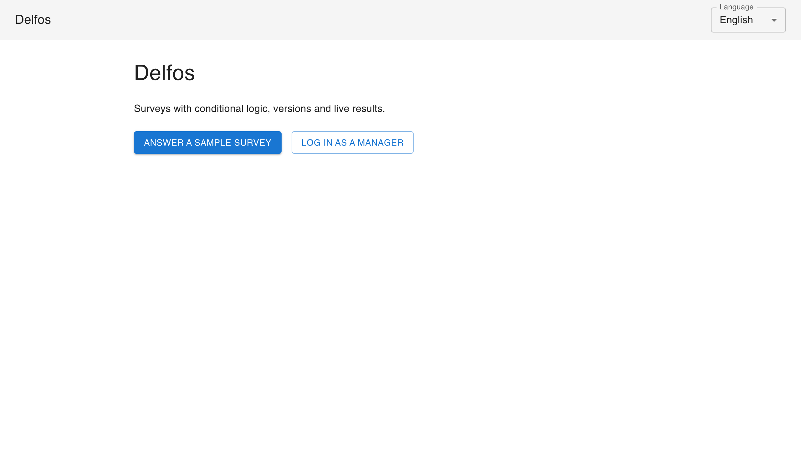
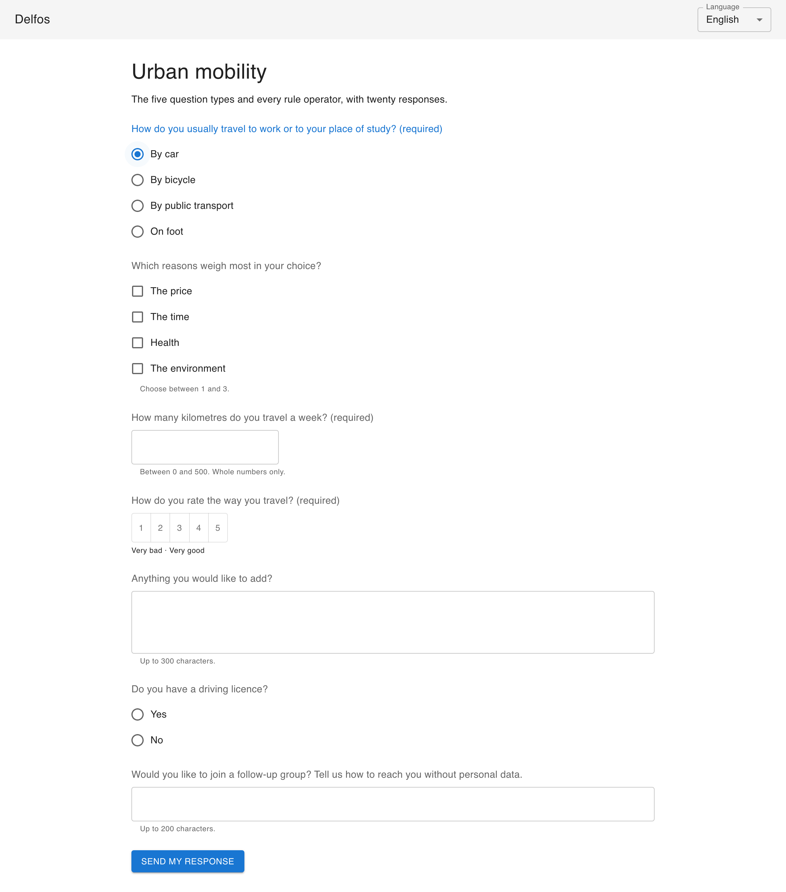
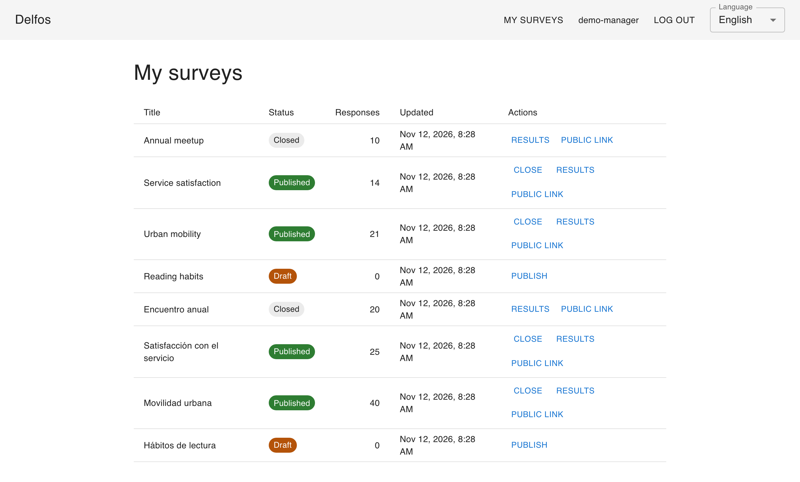
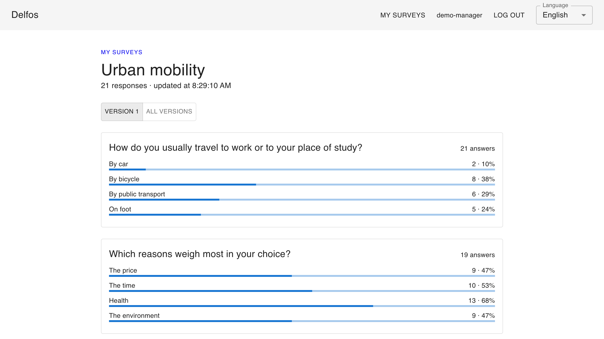

# Delfos

[](https://github.com/majimtor/delfos/actions/workflows/ci.yml)
[](LICENSE)

Delfos is a survey platform: managers build surveys with conditional logic,
publish and version them, watch results arrive and export them; respondents
answer from the web or from a mobile application.

## Live demo

- Web: <https://delfos.manuelalejandro.com>
- API: <https://api.delfos.manuelalejandro.com/api/v1/health>
- Android: the APK attached to the
  [latest release](https://github.com/majimtor/delfos/releases/latest),
  signed with a throwaway debug key, so Android warns at install and a
  newer release installs only after removing the previous one.

The demo runs on free tiers: the API sleeps after fifteen minutes without
traffic and takes up to two minutes to wake outside the hours when
the keep-alive workflow keeps it up (06:00 to 24:00 UTC); the web shows a
wait screen meanwhile. The demo data is reset every day and at every start
of the API. Log in with the accounts listed under [Demo data](#demo-data).
Four slices are in: answering surveys with conditional logic and live
results, building them in the browser with versions and exports, the
invited mode, the administrators' accounts and results pushed as events,
and the mobile client that answers surveys and shows results on Android,
with iOS compiled in CI; what remains is in [PLAN.md](PLAN.md).

## A tour

A one-minute recording of the path, from the sample survey to the
results that update:

[tour.webm](https://github.com/user-attachments/assets/937cb056-7e97-415c-b389-20471704e4b9)



Answering the sample survey: choosing "By car" makes the question about
the driving licence appear. The rules are evaluated on the server, and
the web only shows what the server says is visible.



The manager's list: the sample surveys in both languages, their state,
their response counts and the actions each state allows.



The results of a survey, per version or across the versions that are
comparable, refreshed while responses arrive.



## Where to look

- [PLAN.md](PLAN.md): what gets built, in which order, with which stack and
  why, how long each step takes, and how the result stays alive.
- [docs/adr/](docs/adr/README.md): the decisions that are expensive to
  reverse, each with its alternatives and the condition that reopens it.
- [docs/engineering-rules.md](docs/engineering-rules.md): the rules every
  change in this repository follows.
- [docs/accessibility.md](docs/accessibility.md): what was checked on the
  public pages, what was fixed and what remains.
- [docs/known-issues.md](docs/known-issues.md): what is known not to work
  or to work within limits, and the figures read at each quarterly check.

## Planned layout

| Directory | Content | Language |
| --- | --- | --- |
| `api/` | HTTP API on Spring Boot | Kotlin |
| `shared/` | Rules evaluator and contract models shared by server and mobile | Kotlin Multiplatform |
| `web/` | Single-page application | TypeScript, React |
| `mobile/` | Android-first application | Kotlin, Compose Multiplatform |
| `contract/` | OpenAPI contract and conformance cases | YAML, JSON |

## Run it

One command starts PostgreSQL 18 and the API with the demo data, on port 8080:

```sh
docker compose -f deploy/compose.yaml up --build
```

Then `http://localhost:8080/api/v1/public/surveys/demo-movilidad` answers, and
the manager operations accept the accounts below. The database listens on
`localhost:5433`.

## Demo data

With `DELFOS_SEED_ENABLED=true` the API applies the demo data at startup and
resets it on every start: three accounts and the sample surveys in Spanish.
The accounts are fictitious and their password is public on purpose.

| Account | Password | Role |
| --- | --- | --- |
| `demo-manager` | `delfos-demo` | Owns the sample surveys |
| `demo-manager-2` | `delfos-demo` | Owns one survey, to show that managers only see their own |
| `demo-admin` | `delfos-demo` | Administrator: creates and disables accounts, sees no other manager's surveys |

Sample surveys of `demo-manager`, in Spanish: an unpublished draft, a
published survey with the five question types and every rule operator (40
responses), a survey with a superseded first version and a published second
one (25 responses across both), and a closed survey (20 responses). The
same four exist in English with fewer responses (`demo-reading`,
`demo-mobility`, `demo-service` and `demo-meetup`), and `demo-manager-2`
owns one survey in each language. The published ones can be answered at
`/s/demo-movilidad` or `/s/demo-mobility` on the web, which offers the one
in the interface language, or through `/api/v1/public/surveys/<public id>`
on the API. Running the seed again is the reset: it removes everything the
demo accounts own and recreates the sample surveys.

`demo-manager` also owns one survey per language in invited mode
(`demo-taller`, `demo-workshop`), each with five single-use invitations of
which the first two are already used. Their tokens are public on purpose,
`<public id>-<n>` with `n` from 1 to 5, so `?invitation=demo-taller-3`
opens the Spanish one; a real invitation gets a random token that is shown
once.

## Working on the repository

After cloning, point Git at the versioned hooks and install
[gitleaks](https://github.com/gitleaks/gitleaks/releases) so that a commit
containing a secret is blocked before it exists:

```sh
git config core.hooksPath .githooks
```

Markdown is checked with `markdownlint-cli2`; the configuration lives in
`.markdownlint-cli2.yaml`.

The Kotlin builds use the Gradle wrapper at the repository root and provision
the JDK they declare, so no Java installation is needed beyond one that can
start Gradle (Java 17 or newer):

```sh
./gradlew -p shared check
./gradlew -p api check
```

The API tests start PostgreSQL 18 in a container, so Docker must be running.

The shared module builds for the JVM by default. Its Android and iOS targets
are switched on with `-Pdelfos.android=true` (needs the Android SDK, found
through `ANDROID_HOME` or `shared/local.properties`) and `-Pdelfos.ios=true`
(needs Xcode); `check` then runs the conformance suite on every target that
the machine can run.

The mobile client lives in `mobile/`: the whole application is a Compose
Multiplatform library (`mobile/app`) and `mobile/androidApp` is the Android
application around it. It answers a survey from its code or link, with the
rules evaluated on the device, and after logging in lists the manager's
surveys and shows the results of a published version; the session token is
kept in the Android keystore or the iOS keychain. With the Android SDK
installed, the host tests and the debug APK build with:

```sh
./gradlew -p mobile :app:testAndroidHostTest :androidApp:assembleDebug
```

`:androidApp:assembleRelease` builds the minified APK that the release
workflow attaches to each GitHub release.

The APK talks to the public API. A debug build for the Android emulator
reaches the compose stack on the development machine with
`-Pdelfos.apiBaseUrl=http://10.0.2.2:8080/api/v1`. On a Mac with Xcode,
`mobile/iosApp/iosApp.xcodeproj` builds and runs the iOS application in the
simulator: its build phase runs the Gradle task that links the Kotlin
framework, and Xcode needs `JAVA_HOME` (for example through
`org.gradle.java.home` in `~/.gradle/gradle.properties`). The iOS
application is compiled in CI and not distributed (ADR 0005).

The web client lives in `web/` and needs the Node version in `web/.node-version`:

```sh
cd web && npm ci && npm run check
npm run dev
```

`npm run check` lints, checks formatting, verifies that both message
catalogues match the code, runs the unit tests and builds. The development
server expects the API at `http://localhost:8080`, or at `VITE_API_BASE_URL`.

The end-to-end path in `web/e2e/` drives the built web in Chromium through
a stranger's visit, against the locally seeded API, and checks every page
with axe. With the compose stack running:

```sh
cd web && npx playwright install chromium && npm run build && npm run e2e
```

The screenshots in `docs/media/` and the tour video come from `web/media/`:
the same path in English, with pauses between steps so that it can be
watched. With the compose stack running:

```sh
cd web && npm run build && npm run media
```

The screenshots replace the committed ones; the video lands in
`web/test-results/media/tour.webm`. Look at both before committing or
publishing them.

## Deployment

Everything that deploys the demo is declared in the repository:

- `deploy/render.yaml`: the API as a Render Blueprint, built from
  `deploy/Dockerfile` on every push to `main` whose checks pass. The
  database is PostgreSQL on Neon; its credentials and the demo reset token
  live in the service's environment.
- `web/wrangler.jsonc`: the web as a Cloudflare Worker that serves the
  built files as static assets, deployed by the `web-deploy` job of the CI
  workflow after the same checks, with `CLOUDFLARE_API_TOKEN` and
  `CLOUDFLARE_ACCOUNT_ID` from the repository secrets.
- `.github/workflows/keep-alive.yml`: requests the liveness probe every ten
  minutes from 06:00 to 24:00 UTC, as far as GitHub runs the schedule
  (see `docs/known-issues.md`).
- `.github/workflows/demo-reset.yml`: applies the demo seed again every day
  at 05:50 UTC through `POST /api/v1/demo/reset`, with
  `DELFOS_SEED_RESET_TOKEN` from the repository secrets.
- `.github/workflows/release-please.yml`: keeps a release pull request
  open with `CHANGELOG.md` and the next version in `version.txt`, computed
  from the Conventional Commits on `main`, and tags the version when that
  pull request merges. With `RELEASE_PLEASE_TOKEN` in the repository
  secrets (a fine-grained token of the maintainer limited to this
  repository, with write access to contents and pull requests) the pull
  request gets its checks; without it, closing and reopening it triggers
  them.

The decision and the measured numbers are in ADR 0016.

## Licence

MIT. See [LICENSE](LICENSE).
